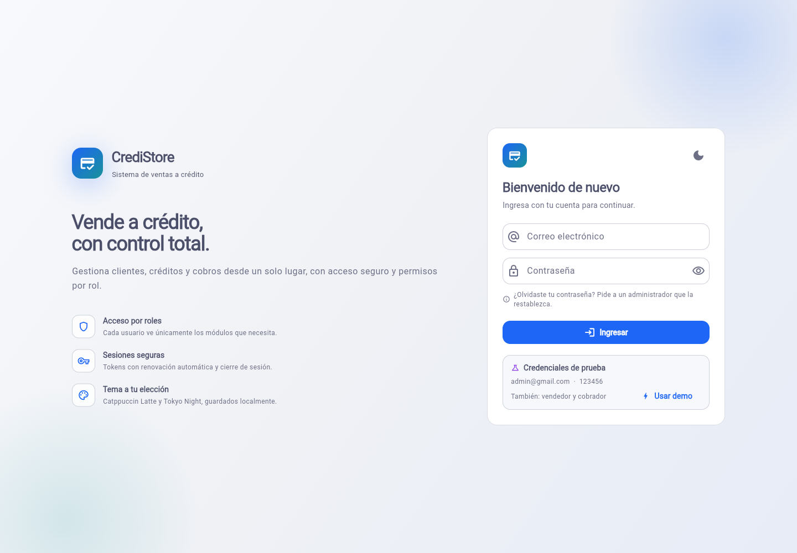
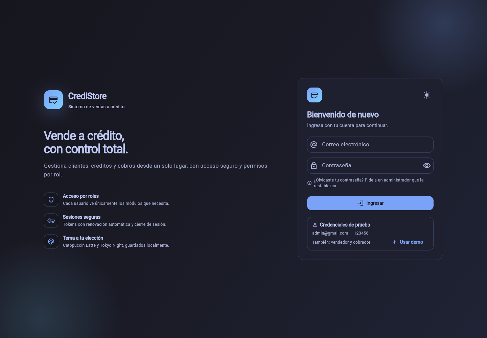
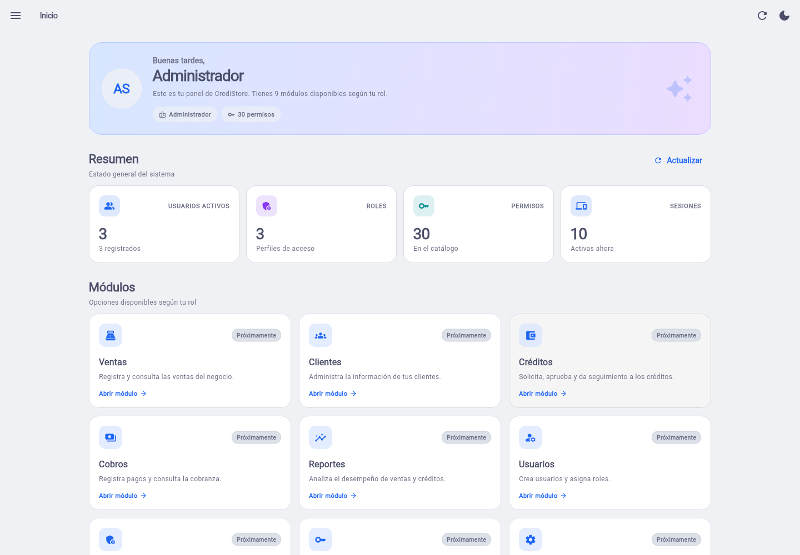
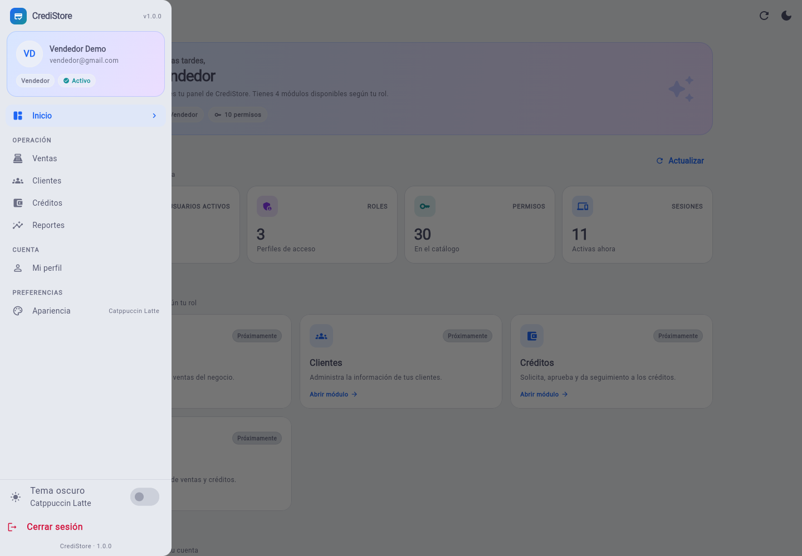

# CrediStore · Sistema de ventas a crédito

Primera entrega del sistema: un **API REST en Go** con autenticación, RBAC y
sesiones, y una **app Flutter web** con login, home, menú lateral por rol y
preferencias de tema. El proyecto incluye además los scaffolds de Linux y Android.

| Login claro · Catppuccin Latte | Login oscuro · Tokyo Night |
|:---:|:---:|
|  |  |

| Home del administrador | Drawer del vendedor (solo sus módulos) |
|:---:|:---:|
|  |  |

## Stack

| Componente | Versión |
|---|---|
| Go | 1.26.5 |
| Gin | 1.12.0 |
| pgx / pgxpool | v5.11.0 |
| sqlc | v1.30.0 |
| golang-migrate | v4.20.1 |
| Air | v1.65.3 |
| PostgreSQL | 17 (Docker Compose) |
| Flutter | 3.44.6 · Dart 3.12.2 |

## Estructura

```text
new_store/
├── server/                  # API REST en Go
│   ├── cmd/api/             # arranque del servidor
│   ├── cmd/seed/            # migraciones + datos de prueba
│   ├── db/migrations/       # migraciones up/down (embebidas con go:embed)
│   ├── db/queries/          # consultas SQL para sqlc
│   ├── internal/            # auth, RBAC, productos, HTTP, seed
│   ├── scripts/e2e.sh       # suite E2E de auth/RBAC (61 comprobaciones)
│   ├── scripts/e2e-products.sh # suite E2E de productos y fotos (40)
│   ├── .air.toml            # recarga en caliente
│   ├── docker-compose.yml   # PostgreSQL 17 (puerto configurable)
│   ├── Makefile
│   └── README.md            # documentación detallada del API
├── app/                     # app Flutter
│   ├── lib/core/            # red, almacenamiento, tema y utilidades
│   ├── lib/features/        # auth, home, productos, perfil, preferencias
│   ├── test/                # 37 pruebas (módulos, ventas, edición y PDF)
│   └── README.md
├── docs/
│   ├── database.md          # modelo ER, relaciones y reglas de integridad
│   ├── diagrams/            # diagrama ER (SVG/PNG + generador)
│   └── screenshots/
└── README.md
```

## Inicio rápido

### Requisitos

- Docker + Docker Compose
- Go 1.26.5
- Flutter 3.44.6
- `sqlc` 1.30, `golang-migrate` y `air` (para desarrollo)

> El proyecto usa el puerto **8081** para el API y el **5433** para PostgreSQL,
> de modo que no choca con un Postgres que ya esté escuchando en 5432.

### 1. Servidor

```bash
cd server
cp .env.example .env      # ya existe una configuración de desarrollo lista
make up                   # levanta PostgreSQL 17 en Docker
make air                  # API con recarga en caliente en http://localhost:8081
```

Al iniciar, el API:

1. espera a que PostgreSQL esté disponible;
2. aplica las migraciones embebidas con golang-migrate;
3. carga permisos, roles y usuarios de prueba de forma idempotente.

También puedes usar `make dev` (levanta la base y Air) o `make run` (sin Air).
La documentación del API está en [server/README.md](server/README.md) y hay
ejemplos ejecutables en [server/api.http](server/api.http).

### 2. App Flutter

```bash
cd app
flutter pub get
flutter run -d chrome      # o: flutter run -d linux
```

La app apunta por defecto a `http://localhost:8081/api/v1` en web y escritorio,
y a `http://10.0.2.2:8081/api/v1` en el emulador de Android. Para usar otra IP:

```bash
flutter run -d chrome --dart-define=API_BASE_URL=http://192.168.1.10:8081/api/v1
```

### 3. Build web de producción

```bash
cd app
flutter build web --release \
  --dart-define=API_BASE_URL=https://api.tudominio.com/api/v1

# Prueba local del artefacto
python3 -m http.server 5173 --directory build/web
```

El resultado queda en `app/build/web`. Incluye una pantalla de carga con la
identidad de CrediStore, favicon, iconos PWA y el manifest. Si se publica en una
subruta, añade `--base-href /credistore/`. Recuerda incluir el dominio del front
en `CORS_ORIGINS`.

### Credenciales de prueba

| Correo | Contraseña | Rol |
|---|---|---|
| `admin@gmail.com` | `123456` | Administrador |
| `vendedor@gmail.com` | `123456` | Vendedor |
| `cobrador@gmail.com` | `123456` | Cobrador |

La contraseña del seed se puede cambiar con `SEED_PASSWORD`. El seed no
restablece contraseñas de usuarios que ya existen.

## Roles y menú

El menú lateral se construye con los **permisos efectivos** que devuelve el API
(`/auth/me`), no con un rol hardcodeado. Los módulos se muestran **solo en el
menú**; el dashboard ya no incluye la cuadrícula de módulos.

| Rol | Permisos principales | Módulos visibles |
|---|---|---|
| `admin` | Todos (37) | Productos, Ventas, Clientes, Créditos, Cobros, Reportes, Usuarios, Roles, Permisos, Configuración |
| `vendedor` | Productos (lectura), clientes, ventas, créditos y reportes | Productos, Ventas, Clientes, Créditos, Reportes |
| `cobrador` | Clientes, créditos, pagos y reportes | Clientes, Créditos, Cobros, Reportes |

**Productos** ya es funcional (listado, búsqueda, filtros, alta, edición,
borrado y galería de fotos con carrusel; mínimo 3 fotos). El **margen** solo se
muestra a quien tiene `products.view_margin` (el admin); el vendedor no lo recibe
ni lo ve en la UI.

**Usuarios** también es funcional para el administrador: listado, filtros, alta,
edición, eliminación y cambio de roles.

**Clientes** ya es funcional (nombre, dirección, ciudad, código postal, teléfono,
correo y estado: prospecto, cliente, en pago o liquidado), con búsqueda, filtros
y CRUD.

**Ventas** ya es funcional: cliente, vendedor, fecha, estado, varias partidas con
cantidad/subtotal, total calculado, pago de contado o crédito y plan de pagos con
anticipo, interés y mensualidades. Las ventas se pueden **editar** desde su
detalle (cliente, vendedor, fecha, estado, partidas y plan); al guardar se
recalculan el total y el plan de pagos. El admin configura anticipos, plazos e
interés desde el módulo **Configuración de crédito** (también accesible desde
Ventas). El plan se puede exportar a PDF, correo o WhatsApp.
Los módulos de créditos, cobros, reportes, roles, permisos y configuración aún
muestran una pantalla de “Disponible próximamente”.

## Base de datos

El esquema actual cubre autenticación, RBAC, sesiones, catálogo, clientes,
ventas, planes de pago y configuración de crédito. El diagrama ER y el detalle
de claves foráneas están en [docs/database.md](docs/database.md).

- `customers` guarda clientes y su estado; las ventas los referencian.
- `sales`, `sale_items` y `sale_payments` guardan la venta, sus partidas y el
  plan de pagos. `sales.total` se calcula con un trigger desde `sale_items`.
- `credit_settings` es la configuración única de anticipos, plazos e interés;
  solo el admin la modifica.
- `products` se relaciona con `sale_items`; su `margin` se genera como
  `price - cost`.
- `product_images` guarda la galería (1 producto → N fotos, `ON DELETE CASCADE`).
  Los archivos viven en `server/downloads/products/...` y se sirven en
  `/downloads`; se exige un mínimo de 3 fotos por producto.
- `users` 1:N `sessions`.
- `users` N:M `roles` a través de `user_roles`.
- `roles` N:M `permissions` a través de `role_permissions`.
- `user_roles.assigned_by` → `users` es opcional (`ON DELETE SET NULL`).
- Los borrados en pivotes y sesiones son `ON DELETE CASCADE`.

## Temas

- **Claro:** Catppuccin Latte. Es el tema por defecto.
- **Oscuro:** Tokyo Night.

El cambio se aplica al instante desde el icono del AppBar, el switch del drawer
o la pantalla **Apariencia**, y se guarda en `shared_preferences` con la clave
`preferences.theme_mode` (`light` / `dark`).

## API y seguridad

- Login con access token JWT (15 min) y refresh token opaco (7 días).
- El refresh token se guarda **hasheado** (SHA-256) en la tabla `sessions` y se
  **rota** en cada refresh.
- Cada petición autenticada valida la sesión contra la base de datos, por lo que
  un logout o la desactivación de un usuario surten efecto de inmediato.
- Los permisos se comprueban en el servidor con middleware; el menú de la app es
  una representación de esos permisos, no la fuente de autorización.

## Pruebas y verificación

```bash
# Servidor
cd server
make test                 # pruebas unitarias
go vet ./...
make e2e                  # 61 comprobaciones E2E de auth/RBAC
make e2e-products         # 41 comprobaciones E2E de productos y fotos

# App
cd app
flutter analyze
flutter test              # 37 pruebas (36/37; app_config_test ajeno)
flutter build web         # verificado: build/web
```

Verificaciones realizadas en esta entrega:

- `go build ./...`, `go test ./...` y `go vet ./...`.
- Migraciones y seed contra PostgreSQL 17 real.
- Suite E2E del API: **61/61** (login, refresh, logout, RBAC, sesiones, CRUD de
  usuarios/roles/permisos, validaciones y CORS).
- Suite E2E de productos: **41/41** (CRUD, margen, servicios, duplicados,
  búsqueda, filtros, alta multipart con 3 fotos, agregar/reemplazar/eliminar
  fotos, mínimo de 3, archivos inválidos, `/downloads`, soft delete, permisos
  del vendedor y margen oculto para el vendedor).
- Arranque con Air v1.65.3 y hot reload.
- `flutter analyze` sin incidencias y `flutter build web` correcto.
- Se agregaron once pruebas de regresión: semántica al seleccionar fotos, al
  agregar una foto desde la galería, alta completa desde la página de productos,
  layout móvil del resumen en 2 columnas, cambio de rol desde Usuarios, alta de
  clientes, dos pruebas de exportación de ventas (texto del plan y PDF), alta de
  una venta completa desde el formulario, edición de la configuración de crédito
  y edición de una venta existente. Las once pasan. La suite completa queda en
  **36/37**: el único fallo es `app_config_test`, que espera `10.0.2.2` mientras
  `AppConfig` usa la IP LAN `192.168.100.16`.
- El servidor de productos y su galería quedó verificado con Go y la suite E2E
  de 41 comprobaciones.
- Pantalla de carga web verificada: aparece al navegar y se retira con el primer
  frame de Flutter.
- Flujo real en Chrome headless contra el API: login claro/oscuro, home del
  administrador y drawer del vendedor con sus módulos filtrados.

## Notas para producción

1. Cambia `JWT_SECRET`, `POSTGRES_PASSWORD` y la contraseña del administrador.
2. Usa `SEED_ON_START=false` y sirve el API por HTTPS.
3. Restringe `CORS_ORIGINS` a los dominios reales.
4. En la app, sustituye `shared_preferences` por `flutter_secure_storage` para
   los tokens y elimina `usesCleartextTraffic` del manifiesto Android.
5. Añade rate limiting al login y auditoría de eventos si el sistema lo requiere.

## Próximos pasos

Implementar los módulos de negocio pendientes: cobranza, reportes y pantallas de
administración de roles/permisos.
La base de autenticación y autorización ya está lista para recibirlos.

## Despliegue en producción

La API y PostgreSQL se despliegan con Docker y se integran al **Nginx que ya
tengas instalado** mediante un único archivo de sitio:
[deploy/nginx/api_store](deploy/nginx/api_store). Ese mismo archivo sirve el
build de **Flutter web** en `/app/` y hace proxy al API en `/api/v1`, por lo que
no hace falta CORS entre ambos. La guía completa está en
[deploy/README.md](deploy/README.md). La API se publica solo en loopback; tu
Nginx conserva el control de los puertos 80/443 y de los certificados.
PostgreSQL se inicializa con las bases `api-store` (API) y `xapari` (otro
servicio).
