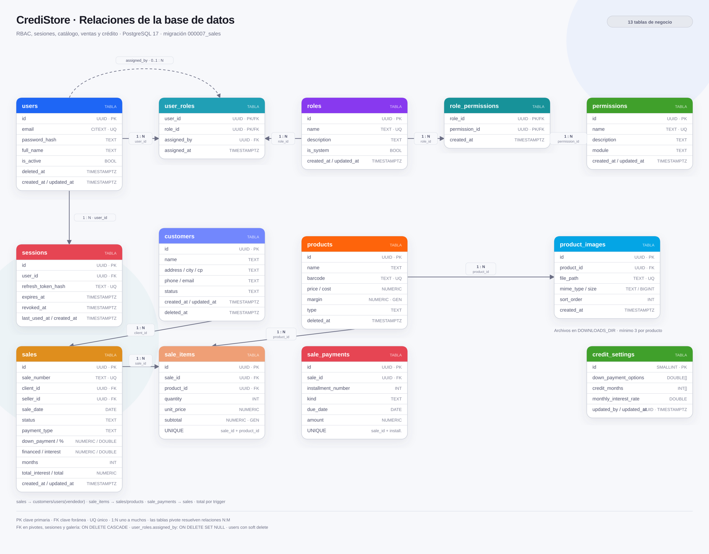
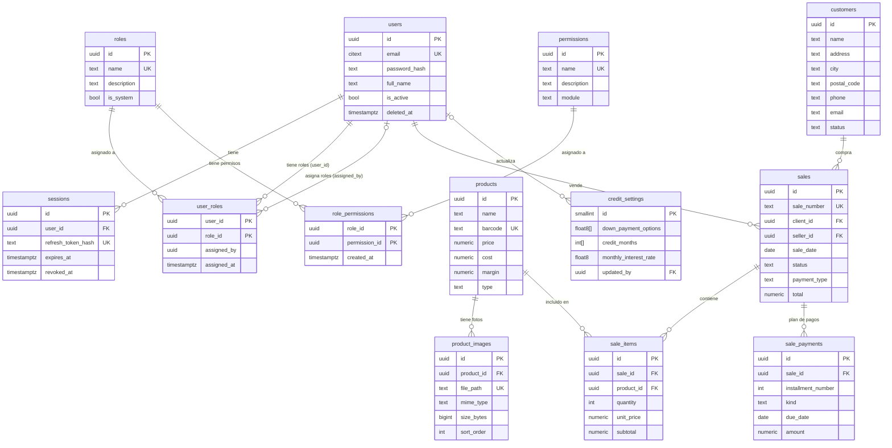

# Modelo de datos

Base de datos del sistema de ventas a crédito: autenticación, RBAC, sesiones,
catálogo, clientes, ventas y planes de pago. PostgreSQL 17 · migración
`000007_sales`.



## Diagrama ER



`customers` guarda los estados `prospecto`, `cliente`, `en_pago` y `liquidado`;
el código postal es texto para conservar ceros iniciales. Las ventas referencian
al cliente.

`products` se relaciona con `product_images` (1 producto → N fotos, `ON DELETE
CASCADE`) y con `sale_items`. Las imágenes se guardan en
`DOWNLOADS_DIR/products/<producto>/` y el API las publica en `/downloads/...`.
La regla de **mínimo 3 fotos** se aplica en la capa de servicio (no es un CHECK
de PostgreSQL) para permitir la creación transaccional del producto con sus
archivos.

Una venta pertenece a un cliente y a un vendedor (`users` con rol `vendedor`).
`sales.total` se calcula con el trigger `sale_items_refresh_total` a partir de
los subtotales de `sale_items`; `sale_items.subtotal` es una columna generada
(`quantity * unit_price`). El plan de pagos queda en `sale_payments`
(anticipo, mensualidades o contado). `credit_settings` es una tabla singleton
con los anticipos, plazos e interés mensual que solo el admin modifica.

## Relaciones y claves foráneas

| Tabla origen | Columna | Tabla destino | Cardinalidad | ON DELETE |
|---|---|---|---|---|
| `sessions` | `user_id` | `users` | 1 usuario → N sesiones | `CASCADE` |
| `user_roles` | `user_id` | `users` | 1 usuario → N asignaciones | `CASCADE` |
| `user_roles` | `role_id` | `roles` | 1 rol → N asignaciones | `CASCADE` |
| `user_roles` | `assigned_by` | `users` | 0..1 usuario → N asignaciones | `SET NULL` |
| `role_permissions` | `role_id` | `roles` | 1 rol → N permisos | `CASCADE` |
| `role_permissions` | `permission_id` | `permissions` | 1 permiso → N roles | `CASCADE` |
| `product_images` | `product_id` | `products` | 1 producto → N fotos | `CASCADE` |
| `sales` | `client_id` | `customers` | 1 cliente → N ventas | `RESTRICT` |
| `sales` | `seller_id` | `users` | 1 vendedor → N ventas | `RESTRICT` |
| `sale_items` | `sale_id` | `sales` | 1 venta → N partidas | `CASCADE` |
| `sale_items` | `product_id` | `products` | 1 producto → N partidas | `RESTRICT` |
| `sale_payments` | `sale_id` | `sales` | 1 venta → N pagos | `CASCADE` |
| `credit_settings` | `updated_by` | `users` | admin que actualizó | `SET NULL` |

Las dos relaciones **N:M** se resuelven con tablas pivote y una clave primaria
compuesta:

- **Usuarios ↔ roles:** `user_roles (user_id, role_id)`.
- **Roles ↔ permisos:** `role_permissions (role_id, permission_id)`.

La ruta efectiva de autorización es:

```text
users → user_roles → roles → role_permissions → permissions
```

## Tablas

| Tabla | Propósito | Campos clave |
|---|---|---|
| `users` | Usuarios del sistema | `id`, `email`, `password_hash`, `is_active`, `deleted_at` |
| `roles` | Roles de acceso | `id`, `name`, `is_system` |
| `permissions` | Catálogo de permisos | `id`, `name`, `module` |
| `user_roles` | Asignación N:M de roles a usuarios | `(user_id, role_id)`, `assigned_by` |
| `role_permissions` | Asignación N:M de permisos a roles | `(role_id, permission_id)` |
| `sessions` | Refresh tokens activos/revocados | `id`, `user_id`, `refresh_token_hash`, `expires_at` |
| `products` | Catálogo de productos y servicios | `id`, `name`, `barcode`, `price`, `cost`, `margin`, `type` |
| `customers` | Clientes y su estado | `id`, `name`, `address`, `city`, `postal_code`, `phone`, `email`, `status` |
| `product_images` | Galería de fotos de productos | `id`, `product_id`, `file_path`, `mime_type`, `size_bytes`, `sort_order` |
| `sales` | Ventas/cotizaciones y plan | `id`, `sale_number`, `client_id`, `seller_id`, `sale_date`, `status`, `payment_type`, `total` |
| `sale_items` | Partidas de una venta | `id`, `sale_id`, `product_id`, `quantity`, `unit_price`, `subtotal` |
| `sale_payments` | Anticipo/mensualidades/contado | `id`, `sale_id`, `installment_number`, `kind`, `due_date`, `amount` |
| `credit_settings` | Anticipos, plazos e interés | `id`, `down_payment_options`, `credit_months`, `monthly_interest_rate`, `updated_by` |

`schema_migrations` también existe en `public`, pero es la tabla interna de
golang-migrate y no forma parte del modelo de negocio.

## Reglas de integridad y diseño

- Todas las claves primarias son `UUID` generadas con `gen_random_uuid()`.
- `users` usa **soft delete** (`deleted_at`). El correo es único solo entre
  usuarios vigentes, mediante el índice parcial `users_email_active_uidx`.
- `roles.name` y `permissions.name` son únicos. Los roles de sistema
  (`is_system = true`) no se eliminan desde la API.
- `sessions.refresh_token_hash` es único y guarda el **SHA-256** del refresh
  token, nunca el token en claro. `revoked_at` permite revocar sin borrar.
- Borrar un usuario elimina en cascada sus sesiones y sus asignaciones de rol.
  Si era el `assigned_by` de otra asignación, esa referencia queda en `NULL`.
- Borrar un rol elimina sus filas en `user_roles` y `role_permissions`; borrar un
  permiso elimina sus filas en `role_permissions`.
- `updated_at` se actualiza automáticamente con el trigger `set_updated_at()` en
  `users`, `roles`, `permissions`, `products` y `product_images`.
- `products.margin` es una columna generada (`price - cost`) y no se puede
  desincronizar. `products.barcode` es único solo entre productos vigentes, y
  `products.deleted_at` implementa el borrado lógico del catálogo.
- `products.type` solo admite `product` o `service`.
- `customers` usa soft delete (`deleted_at`). `status` solo admite
  `prospecto`, `cliente`, `en_pago` o `liquidado`.
- `sales.status` solo admite `cotizacion`, `venta` o `cancelada`;
  `payment_type` admite `contado` o `credito`. `sale_number` es único y se
  genera con una secuencia (`V-000001`).
- El total de la venta no se acepta desde el cliente: lo recalcula el trigger
  al insertar/actualizar/eliminar `sale_items`.
- `credit_settings` es singleton (`id = 1`); sus anticipos son porcentajes y el
  interés se aplica mensualmente al saldo financiado. Solo `credit_settings.update`
  (admin) puede modificarla.
- `product_images.file_path` es único y apunta a un archivo dentro de
  `DOWNLOADS_DIR`. Borrar físicamente un producto elimina sus fotos por
  `CASCADE`; el soft delete conserva la galería.
- El mínimo de 3 fotos por producto se valida al crear (multipart con 3 archivos)
  y al eliminar (no se permite bajar de 3). Los formatos aceptados son JPG, PNG
  y WebP, con máximo 5 MB por archivo.

## Verificación en vivo

Para comprobar las relaciones directamente en PostgreSQL:

```sql
SELECT tc.table_name AS origen,
       kcu.column_name AS columna,
       ccu.table_name AS destino,
       ccu.column_name AS columna_destino,
       rc.delete_rule AS on_delete
FROM information_schema.table_constraints tc
JOIN information_schema.key_column_usage kcu
  ON tc.constraint_name = kcu.constraint_name
 AND tc.constraint_schema = kcu.constraint_schema
JOIN information_schema.constraint_column_usage ccu
  ON ccu.constraint_name = tc.constraint_name
 AND ccu.constraint_schema = tc.constraint_schema
JOIN information_schema.referential_constraints rc
  ON rc.constraint_name = tc.constraint_name
 AND rc.constraint_schema = tc.constraint_schema
WHERE tc.constraint_type = 'FOREIGN KEY'
  AND tc.table_schema = 'public'
ORDER BY tc.table_name, kcu.column_name;
```

Para regenerar el diagrama:

```bash
python3 docs/diagrams/generate_er.py
rsvg-convert -w 2400 docs/diagrams/database-er.svg \
  -o docs/diagrams/database-er.png
```
